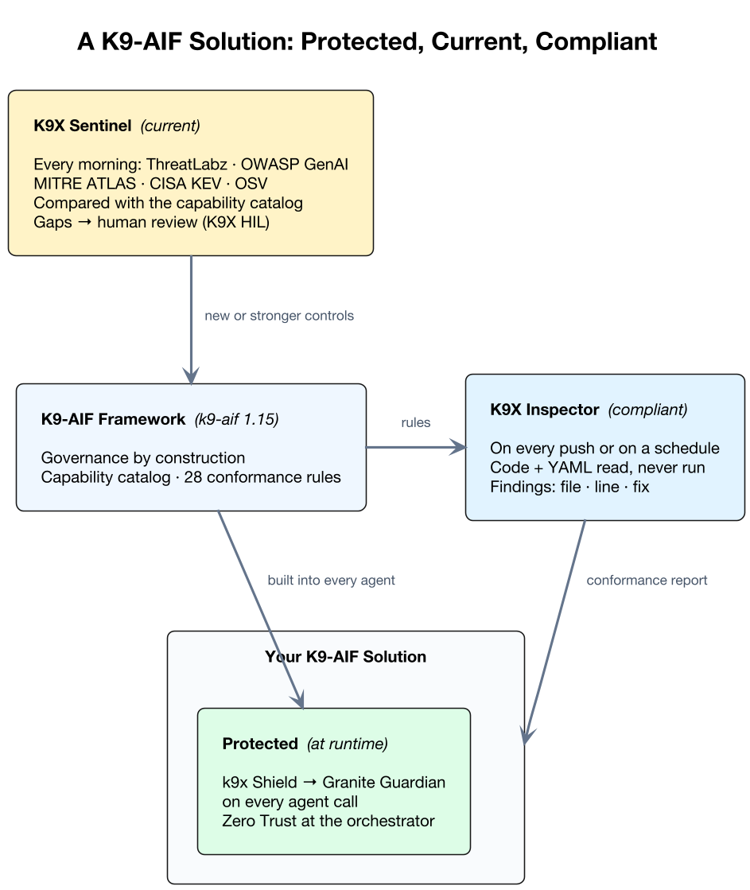
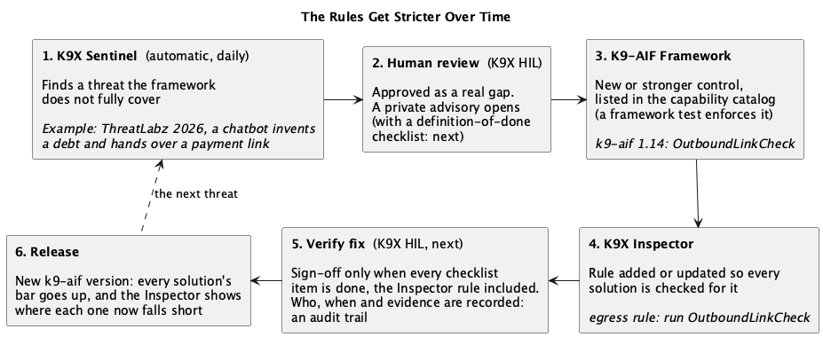

A framework can promise governance. A solution built on it still has to be checked. Someone hardcodes an address, an orchestrator imports agent classes when it should know only its squads, a security setting is switched off "for now". None of that shows up until it matters.

This post is about the two K9X components that close that gap: **K9X Inspector**, which checks that a solution built on K9-AIF follows the framework's rules, and **K9X Sentinel**, which keeps the framework's defences current as new attacks appear. Together with k9x Shield they answer three questions about any K9-AIF solution:

- **Is it protected?** k9x Shield and Granite Guardian, built into every agent.
- **Is it current?** K9X Sentinel, watching new threats every day.
- **Does it comply?** K9X Inspector, on every push.



## From scripts to components

Last year I started with simple scripts. One generated the scaffold code for a K9-AIF application from a template. Others inspected a solution against the rules I cared about: no example running without governance, and no agent calling a language model directly instead of going through the framework. They worked, and they taught me which rules actually catch real mistakes.

As the framework and the ecosystem grew, I wanted every component to be the same kind of thing: **UI based, open source, and able to run locally or in a Podman container.** So the scaffold scripts became K9X Studio ([studio.k9x.ai](https://studio.k9x.ai)), and the inspect scripts became K9X Inspector ([inspector.k9x.ai](https://inspector.k9x.ai)), which keeps evolving as the framework does. Every component's repository has an `ubuntu/` folder with a standard `build-run.sh` that builds and runs it in a container on your own machine. The hosted sites at `*.k9x.ai` are demonstrations of exactly that.

## The first test: the framework's own examples

The first solutions I ran through the Inspector were the framework's own examples. I expected a few warnings. I got a report like this one for ACME Health Insurance:

> **NON-COMPLIANT**: 68% of 28 rules pass. 0 critical, 20 violations, 8 warnings, 1 recommendation.

The findings were real:

- **A hardcoded private IP address in `config.yaml`**, the address of a machine in my home lab. It worked on my network and nowhere else.
- **Orchestrators importing agent classes.** K9-AIF's three-layer rule says an orchestrator knows its squads and a squad knows its agents. Three orchestrators reached past that.
- **Shield not enabled** in the application's configuration.
- **A Python file that did not parse.**

I loved seeing these. Not because the examples were wrong, but because a rule set found them, the same way every time, with the file, the line and the fix. A code review can miss a hardcoded address on line 84. A rule doesn't.

Another out-of-the-box example, EOC (the Enterprise Insurance Operations Center), kept per-squad YAML files next to the one file the framework actually loads, and six of the seven had drifted from it. Turning on Granite Guardian in an example's configuration showed that the setting wasn't yet wired into the framework's governance by construction, so it is now (k9-aif 1.15.0). The DAS (Defense Acquisition System) reference deployment, the framework's showcase, had a few minor findings too, now fixed. Today none of the framework's 12 examples has a violation, and five are fully compliant.

The Framework latest published release is: [pypi.org/project/k9-aif](https://pypi.org/project/k9-aif/)  k9-aif 1.15.0

## Protected: k9x Shield, Granite Guardian, Zero Trust

Since k9-aif 1.15, governance is part of the agent contract. The framework wraps every agent the moment it is defined: the request is checked before the agent runs and the reply after it, and an agent with no governance configured refuses to run in production. The application turns it on once, in `config.yaml`:

- **k9x Shield**: deterministic checks (prompt injection, personal data, outbound links, tool arguments and more), mapped to the OWASP Top 10 for LLM Applications.
- **Granite Guardian**: semantic screening after Shield, for the paraphrased attacks a pattern can't catch. If Guardian is unreachable, requests are refused, not passed through.
- **Zero Trust**: identity, role and risk checks at the orchestrator.

[K9X Satan](/k9x-satan-proving-shield-holds/) fires real attacks at a governed pipeline to show what these layers contain.

## Current: K9X Sentinel

Attacks change faster than any rule list. Every morning K9X Sentinel reads the sources security teams follow: Zscaler ThreatLabz, OWASP GenAI, MITRE ATLAS, CISA KEV, agent-security researchers, and OSV for the framework's own dependencies.

It compares each new threat with the framework's **capability catalog**, a machine-readable list of every Shield check, Guardian risk and Zero Trust component, mapped to OWASP. A framework test fails if a control exists without being listed, so Sentinel judges against what the code really does. Threats the framework doesn't fully cover go to a person for review through K9X HIL. Sentinel itself never changes code. An approved gap becomes a private security advisory or, for a public dependency CVE, an issue.

Sentinel reads attacker-written content all day, so it is built to survive it: its analysis model has no tools, every answer is validated against the catalog, and every finding is decided by a human.

## Compliant: K9X Inspector

K9X Inspector applies the framework's 28 conformance rules to a solution:

- **ABB contracts**: agents extend a framework agent base class.
- **Three-layer decoupling**: router, orchestrator, squad and agent each know only the layer below.
- **One model path**: agents never call a language model directly. Every call goes through the framework's single, consistent entry point (`llm_invoke()`, backed by the model factory and router), so governance, retries and the audit trail apply to every call, whichever model or provider is behind it.
- **Governance**: Shield enabled with its checks, Guardian failing closed, production mode, orchestrators screening their own input.
- **Hygiene**: no secrets in configuration, no committed `.env`, no private IP addresses, valid squad and agent YAML, a current framework version.

It reads the code and the YAML without importing or running anything, so it is safe to point at any repository. Each finding is ranked critical, violation, warning or recommendation, with the file, the line and the fix, and each run comes with a remediation guide. Tracked applications are inspected again on every push (GitHub webhook) or on a schedule.

The rules ship with the framework itself, so the same check also runs from the command line or in CI:

```bash
pip install k9-aif
k9aif inspect path/to/your/solution --fail-on violation
```

An organisation can add its own rules by registering them with the framework's rule registry.

**Does it work only for K9-AIF?** Yes, and that is deliberate. The rules encode the object-oriented analysis and design discipline the framework is built on: abstract contracts that concrete building blocks extend, each layer knowing only the one below it, one entry point for every model call, governance that cannot be skipped. Those principles are what make a K9-AIF solution strong, and the Inspector holds every solution built on the framework to them. It is not a general linter; it points at any solution built on K9-AIF and shows exactly where it falls short of the framework's design.

## The rules get stricter over time

The three pieces form one loop, and it only tightens:

1. **Sentinel** finds a threat the framework doesn't fully cover, and a person reviews it.
2. **The framework** closes the gap with a new or stronger control, and lists it in the capability catalog.
3. **The Inspector** gets a rule that checks solutions actually use it.



One real example: the 2026 Zscaler ThreatLabz research described a chatbot scam that collects an ID, invents a debt and hands over a payment link. k9-aif 1.14 added `OutboundLinkCheck`, which blocks lookalike domains, brands hidden in subdomains and similar tricks in the links an agent sends out. It went into the capability catalog, and the Inspector's egress rule now tells any solution that doesn't run it to add it. The DAS report shows exactly that recommendation.

So a solution built on K9-AIF doesn't just pass a fixed checklist once. Each time the framework learns about a new attack, the bar for every solution built on it goes up, and the Inspector shows each team where it now falls short.

## What's next: checks before every commit

Today the Inspector runs on a push or on a schedule, after the code is already in the repository. The next step is hooks: the same rules running before and after git operations on the developer's own machine, so a violation is caught before it is ever committed. They run in git itself, so they work the same way alongside AI coding assistants such as Claude Code and IBM Bob, or with no assistant at all, and each team can turn them on or off.

## Try it

- **K9X Inspector**: [inspector.k9x.ai](https://inspector.k9x.ai), demo login `demo` / `demo`. Source: [github.com/k9aif/k9x-inspector](https://github.com/k9aif/k9x-inspector).
- **K9X Sentinel**: [sentinel.k9x.ai](https://sentinel.k9x.ai), demo login `demo` / `demo` (gap details stay private).
- **All of it** on one page: [dashboard.k9x.ai](https://dashboard.k9x.ai).

Each runs on your own machine with `ubuntu/build-run.sh` from its repository.

Related posts:

- [k9x Shield: a Chain of Vulnerability Tests](/k9x-shield-chain-of-vulnerability-tests/)
- [K9X Satan: Proving Shield Holds](/k9x-satan-proving-shield-holds/)
- [K9-AIF with CrewAI, LangGraph and the Claude Agent SDK](/k9-aif-with-crewai-langgraph-claude-agent-sdk/)
