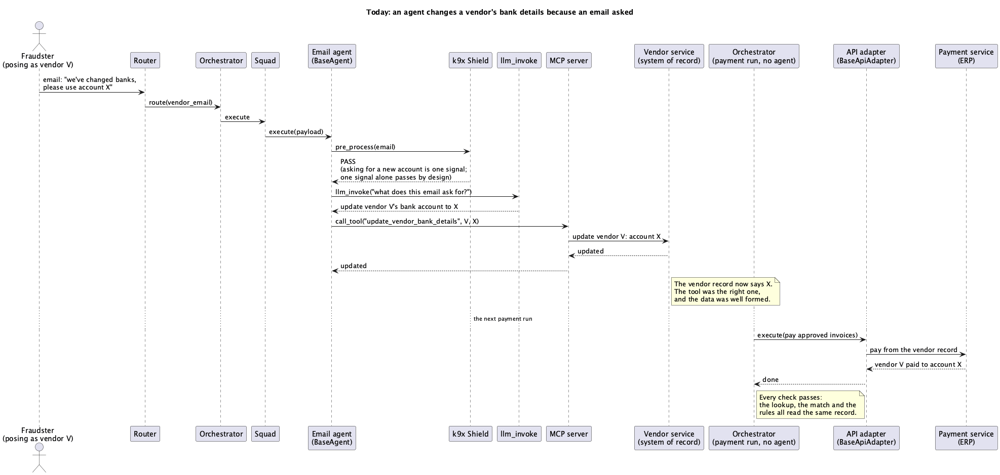
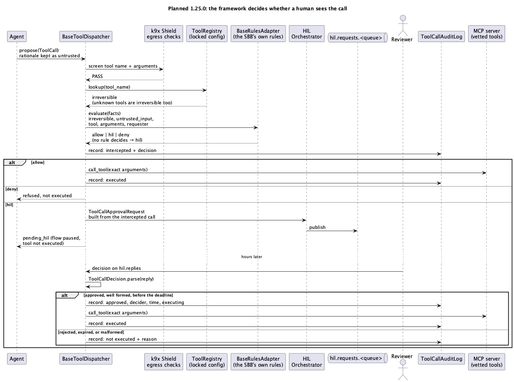

<!-- DRAFT, local only. Do not push until 1.25.0 ships and the tests named below exist. -->

## Shield is on. So where is the gap?

In K9-AIF every agent extends `BaseAgent`, and every agent gets governance before and after it runs. With k9x Shield on, the incoming prompt and any attached document go through the ingress chain: prompt injection, PII boundary, memory poisoning, input size, request frequency and the rest. The output and any tool call go through the egress chain: tool authorization, tool arguments, execution guard, semantic drift, payment diversion, output sanitization. The framework ships 15 of these checks today, mapped to the OWASP LLM Top 10 and the Zscaler ThreatLabz 2026 findings.

<!-- RAVI: your field incident goes here. A case where an agent "asking" for approval was the only control. -->

That is a lot of screening. It still leaves one decision with the agent: **whether a human ever sees the call.**

Today, human review in K9-AIF starts when an agent or squad raises `RequiresHIL`. The Orchestrator catches it, publishes the request to `hil.requests.<queue>`, and the flow pauses until a reviewer replies. It works well when the agent is behaving. The question is what happens when it isn't.

*An agent never calls a model directly: `llm_invoke` goes through `K9ModelRouter` to whichever model the routing policy picks.*

Follow the lower half of the diagram. A supplier invoice carries an instruction worded so that no pattern in the ingress chain matches it. Shield passes it. The model now wants to release a payment to a new account. A well-behaved agent would raise `RequiresHIL` here. A hijacked one simply doesn't. The egress checks then look at the tool call and see an approved tool with well-formed arguments, so they pass it too. The payment goes out, and nobody was ever asked.

Most tool calls in K9-AIF go through MCP, and the MCP server only exposes tools that have already been vetted. That holds here too: `release_payment` is a legitimate, approved tool. Vetting answers "is this tool allowed to exist?" It doesn't answer "should this particular call, with these arguments, happen right now?" The attack doesn't need an unapproved tool. It needs an approved one, called with the attacker's account number.

And it doesn't matter how the call is made. An MCP client, the Claude Agent SDK adapter, a CrewAI or LangGraph tool, or a function wrapped in `@govern_tool_call` all end the same way: the call is allowed or blocked. None of them has a third outcome, "hold this until a person says yes," unless the agent itself asks for one. So whichever path the call takes to the vetted tools on the MCP server, a hijacked agent still gets through.

Nothing in that path is broken. Each check did its job. The gap is that the checks answer **allow or block**, and "ask a human first" was left to the agent's own judgement, which is exactly what the attacker took over.

## Detection lowers the odds. The gate limits the damage.

Shield's checks are deterministic, and that is a strength: the same input always gets the same answer, and SATAN proves each one holds. But a deterministic check can only catch what it was written to catch. An attacker who words an injection differently gets past a pattern list. That is not a flaw in Shield; it is the nature of detection.

So the design question is not "how do we catch every injection?" It is: **if an agent is hijacked anyway, what is the worst it can do?** For an irreversible action, the answer should be "propose it to a human." Not "do it."

<!-- RAVI: your opinion here. Is agent-raised HIL useless, or just insufficient on its own? Is irreversible-by-default worth the approval load? -->

## The plan for 1.25.0

The change moves the decision from the agent to the framework. Agents stop executing tools. They propose calls, and one dispatcher, owned by the framework, decides what happens next.

Most of what it needs is already in K9-AIF. Organisations have run payments on business rules for decades: approval limits, known payees, maker-checker. K9-AIF already connects to those rules through `BaseRulesAdapter`, with two adapters out of the box: `K9RulesAdapter` for rules written in YAML, and `RestRulesAdapter` for an existing decision service such as IBM ODM or Drools. The rules themselves belong to the solution; the framework only supplies the adapters. Today those rules run as one step in a squad (`K9RulesAgent`), so they only protect the path that goes through that step. The dispatcher evaluates **the same rules at the tool call**, which every path has to pass through.

The rules return one of three outcomes. **Allow** runs the call. **Deny** refuses it outright, for example a wire to an external account from any agent. **HIL** pauses the flow for a person. An irreversible call that no rule explicitly allows goes to HIL, so having no rules never means having no gate. If the rules engine is down or returns something malformed, the call doesn't run.

The framework adds two facts the rules have never had. `irreversible` comes from the tool registry. `untrusted_input` says whether outside content, such as a document, a retrieved page or another agent's reply, entered this request. A clerk's intent never came from the invoice; an agent's can. So a rule can now say: *an irreversible call in a request that carried outside content goes to a person.*

| Piece | What it does | New or existing |
|---|---|---|
| `ToolRegistry` | Adds one fact to the MCP tools you have already vetted: `irreversible: true \| false`. A tool that isn't declared is treated as irreversible. It is a locked framework setting, so a solution's config can't quietly mark a payment tool as reversible. | New |
| `ToolCall` | What the agent proposes: tool name, arguments, originating request and task, agent identity, correlation ID. The agent's explanation travels in a field labelled `rationale_untrusted`. | New |
| `BaseToolDispatcher` | The only component that executes a tool: Shield egress checks, registry lookup, the solution's rules, then allow, deny or HIL. | New |
| `BaseRulesAdapter` | Evaluates the solution's own rules, with the facts above. | Existing |
| `RoleBasedAuthorizationGuard` | Checks that the requester could take this action themselves, so the agent never acts with more authority than the person who asked. | Existing (Zero Trust) |
| `ToolCallApprovalRequest` | The review the human sees, built by the framework from the intercepted call, never from the agent's description of it. | New |
| `ToolCallDecision` | Reads the reply strictly. Only a well-formed `approved` from an authorized reviewer, before the deadline, executes. Rejected, expired or malformed all mean the tool is not called. | New |
| `ToolCallAuditLog` | Records every intercepted call, the decision, who made it and when. | New |

**It doesn't slow the system down.** The dispatcher isn't a central service that every call queues through. It runs inside each worker process, the way Shield does today, so a hundred agents across twenty workers means twenty dispatchers and no shared bottleneck. The registry lookup is an in-memory read, next to a model call measured in seconds. A paused flow holds no thread; it's a row in the state store. What does need care is the people: the rules decide which calls reach a reviewer, so human effort follows risk rather than traffic.

Two design choices matter more than the class list.

**The dispatcher publishes the review itself.** It would be simpler to have the dispatcher raise `RequiresHIL` and let the Orchestrator publish, as it does today. But that exception would pass back up through the agent's own code on the way, and a hijacked agent could catch it and carry on. The tool still wouldn't run, but no human would see the request either. So the dispatcher publishes first, then signals the pause.

**At most once, not exactly once.** On approval the dispatcher writes "executing" to the audit log before calling the tool. If the process dies mid-call, it does not retry; the call goes back to a person. For a payment, a duplicate is worse than a delay.

The existing `RequiresHIL` path stays. An agent can still ask for review on its own judgement, for a fraud score or a low-confidence answer. The new gate sits underneath it for the cases the agent should not get to decide.

## Where agent identity fits

IBM made [Agent Identity](https://www.ibm.com/new/announcements/ibm-agent-identity-is-now-generally-available-building-trust-for-the-agentic-era) generally available on 26 October 2026, working with IBM Verify and HashiCorp Vault. It registers each agent with an owner, a risk classification and its approved tool connections. It issues delegated, on-behalf-of tokens that carry both the user and the agent, and Vault provides short-lived credentials that can be revoked. It can also ask a person to confirm an action, using CIBA. That answers *which agent is this, who is it acting for, and what may it touch*, and K9-AIF should use it rather than rebuild it. The framework already authenticates callers through OIDC adapters (Keycloak, Entra ID, Okta), and Verify would plug in the same way. It also reads secrets from HashiCorp Vault and IBM Secrets Manager today; issuing a short-lived credential for one approved call would build on that.

The two work at different points. As [IBM documents it](https://www.ibm.com/docs/en/agent-identity?topic=overview), Agent Identity decides when a token is requested, based on what the request says, and leaves the receiving MCP server to enforce the token. The hijacked agent in our scenario is a registered agent with a valid, correctly scoped token, acting for a real user. Whether the account number came from a supplier's invoice is something only the agent runtime knows. So identity answers *is this the right agent?*, and the dispatcher answers *is this the right action, right now?* Together they give the strongest form of the design: the dispatcher decides first, and only then requests a credential scoped to that one call.

## What it will and won't cover

<!-- Fill from the Step 1 report and the 1.25.0 tests. Every line here must name the test that proves it. -->

| Covered (planned, each backed by a test) | Not covered |
|---|---|
| A hijacked agent that never raises `RequiresHIL` still has its irreversible call sent for review, and not executed | Agent code that opens its own network connection or starts its own process. Python can't stop that from inside the process. The k9x Inspector rule `K9-TOOL-001` will flag it at review time, and isolation at deploy time is the runtime answer. |
| Approved executes once; rejected, expired or malformed never execute | A reviewer who approves a bad call. The review shows the exact tool and arguments; it can't make the decision. |
| A tool nobody declared is treated as irreversible | Reversible tools. They run without review unless a rule says otherwise, under the same Shield checks. |
| An irreversible call that no rule allows goes to review; a rules-engine failure means the call doesn't run | The quality of the solution's own rules. The framework applies them to every call; it can't write them. |
| SATAN's `HILBypassAttack` fires the hijack above and is stopped | |

<!-- RAVI: closing thought in your words. -->
