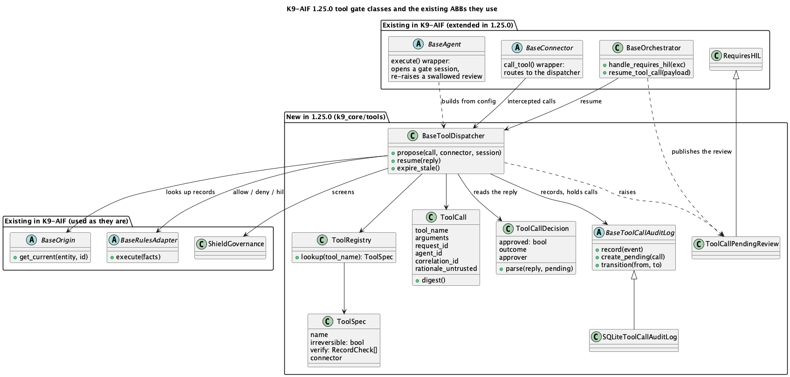

> **Summary.** In an application built on K9-AIF, [k9x Shield](../k9x-shield-chain-of-vulnerability-tests/) screens at every stage: the Router, the Orchestrator and the agent. Most attacks are stopped at the Router or the Orchestrator. Shield is a chain of 15 checks mapped to the [OWASP](https://genai.owasp.org/) Top 10 lists for LLM and agentic applications and to the agent threats [Zscaler ThreatLabz](https://www.zscaler.com/threatlabz) describes, and [K9X Sentinel](../k9x-inspector-and-sentinel-protected-current-compliant/) keeps it current. During testing, the application is attacked with [K9X SATAN](https://satan.k9x.ai) to prove these defences hold.
>
> If an injection does make it to the agent, the agent can only request an action, since whether the action is carried out is decided outside the model, by code, rules and people. K9-AIF also provides business rules through the rules adapters, human review, and a tool gate you can switch on that checks every MCP tool call before it runs. What agents do is logged and reported, so anything unusual is seen and reviewed.

This morning, in a LinkedIn thread about agent identity, I described how I check an agent's work at two gates: once before a tool call goes out, and again on what the agent produces. One of the replies made a fair point. An injected action that fits the task closely enough will pass both gates, so for anything irreversible, the person who owns the request has to confirm it.

That's right, and it made me ask a more basic question: in K9-AIF, what does a "hijacked agent" even mean?

## What an agent hijack is

An AI agent hijack occurs when untrusted content, such as a user message, email, document, or web page, causes an AI agent to act against its intended purpose while using its own permissions and access. This is commonly known as [prompt injection](https://genai.owasp.org/llmrisk/llm01-prompt-injection/). The risk becomes significant when three conditions exist at the same time: a language model makes decisions, the model processes untrusted content, and the agent has access to valuable data or consequential actions. A successful hijack may cause the agent to perform unauthorized actions, reveal sensitive information, or make commitments it was never authorized to make.

## One example: a refund

A customer chats with an online support agent: "My order arrived damaged. Please refund me."

If that agent holds a tool like `issue_refund`, all three conditions are met. The model decides whether to refund and how much, and a cleverly worded message can talk it into a refund that isn't owed, or a larger one. Every check passes, because the request is well formed and the tool is the right one.

## How K9-AIF avoids an agent hijack

**An agent in K9-AIF is our code.** It reaches its tools through a trusted MCP server, and its base class runs the checks around it. In production, no prompt can switch those checks off, give the agent a tool it wasn't built with, or change what it's allowed to do.

**Prompt injection is detected before the model acts on it.** k9x Shield's `PromptInjectionCheck` screens the user's message and what the agent reads, such as attached documents and tool results, and Guardian, where it's enabled, catches reworded attempts that no fixed pattern matches.

**Most flows have no model in them.** K9-AIF has two kinds of path ([more on routing them](../Routing-in-k9-aif/)):

- **Deterministic flows** are most business flows: look up, match, apply the rules, post. Our code decides every step, and the Orchestrator calls the enterprise systems through integration adapters, with no model involved. Condition 1 never holds, so **a deterministic flow can't be hijacked.** Its only risk is what it trusts: if a record it relies on was wrong, it acts on that record faithfully, and the usual business controls deal with that, as they always have.
- **Non-deterministic flows** are where a model decides: it reads free text and chooses what to do. Only these can be hijacked, and a solution built on K9-AIF covers each of the three ways:
  1. **Acting:** agents get request tools into the existing workflows, and the 1.25.0 tool gate sends any irreversible call that the business rules don't allow to a person.
  2. **Revealing:** every caller is authenticated and role-checked, agents use only the tools a trusted MCP server exposes to them, those tools return only what the person may see, and Shield checks what goes out for personal and confidential data.
  3. **Misrepresenting:** k9x Shield, and Guardian where it's enabled, check everything an agent sends out, and the solution answers from its own approved policy text.

**For the refund,** the solution takes the conditions away using what the framework already provides:

| What the solution does                                                                              | Condition it removes or limits | What K9-AIF provides                                                                                                                                                                                                        |
| --------------------------------------------------------------------------------------------------- | -------------------------- | --------------------------------------------------------------------------------------------------------------------------------------------------------------------------------------------------------------------------- |
| Runs deterministic steps without a model                                                            | 1. A model decides         | Integration adapters the Orchestrator calls (API, rules, BPM, data), with no model involved                                                                                                                                 |
| Gives the agent a request tool, not an action tool: `create_refund_request`, not `issue_refund` | 3. A consequential action    | Tools come from a trusted MCP server, which exposes the request tool, not the action; Shield's tool authorization, when configured, refuses tools not on the approved list                                                                                                                     |
| Lets the existing workflow decide                                                                   | 3. A consequential action    | The solution's rules engine, through `BaseRulesAdapter`: a small refund for an order with a delivery problem on record is approved automatically; anything larger, or a second refund on the same order, goes to a person |
| Asks for a person in code, not by the model's choice                                                | 1. A model decides         | `RequiresHIL` raised from the agent's code or a rules step; the Orchestrator publishes the review                                                                                                                         |
| Screens what reaches the model                                                                      | 2. Untrusted content            | k9x Shield detects prompt injection in the message and in what the agent reads; Guardian catches rewordings                                                                                                                 |
| Checks the caller                                                                                   | (who may ask at all)       | Identity at the Router, and Zero Trust role checks at the Orchestrator                                                                                                                                                      |
| Gives each agent only the tools it needs                                                            | 3. A consequential action    | The trusted MCP server exposes only the tools that agent needs (in development, a tool list in the agent's YAML)                                                                                                                                                                             |
| Checks everything an agent sends out                                                                | (what it says and reveals) | k9x Shield on every output, and Guardian where it's enabled                                                                                                                                                                 |

With the request tool, a cleverly worded message can at most get the agent to *submit a request*, and the request meets exactly the rules an online form would meet. **The model can be fooled; the workflow can't be skipped.**

## What K9-AIF 1.25.0 adds

Everything above depends on each solution being built that way. The tool gate makes it the framework's job instead: even if someone gives an agent an action tool, the agent can't use it to skip the workflow. It is switched on with one setting, `security.tool_gate.enabled: true`.

- **Every MCP tool call a K9-AIF agent makes is checked before it runs.** The agent's code doesn't change, and it can't switch the check off. Agent code that tries to go around MCP with its own network call is flagged by Inspector rule K9-TOOL-001.
- **Each tool is declared reversible (rollback) or irreversible (non-rollback).** For example, `create_refund_request` is reversible, so it runs. `issue_refund` is irreversible. A tool nobody declared counts as irreversible.
- **The solution's rules decide** whether an irreversible call runs, is refused, or goes to a person. If no rule allows it, a person decides. Irreversible doesn't mean "always ask a person": it describes the tool: once it runs, it can't be rolled back. Whether a person is needed is the rules' decision, so a small, routine refund can be allowed automatically while anything the rules don't allow waits for a person.
- **An approval runs that exact call, once.** A rejected, expired or late reply never runs it.
- **Everything is recorded:** the call, the decision, who approved it and when.

Each of these is proven by a test that runs against the framework's real agent and tool-call wrapping, orchestrator and audit log, with a stand-in tool server: [31 tests in `test_tool_gate_1_25.py`](https://github.com/k9aif/k9-aif-framework/blob/v1.25.0/k9_aif_abb/tests/test_tool_gate_1_25.py), at the v1.25.0 release.

It's off by default in 1.x, so existing applications don't change when they upgrade, and it becomes the default in 2.0.

## What could still get through

A few things can: an approver who approves without reading, a request that looks entirely normal, a record someone already changed. The best any framework can do is avoid as much as possible, then make sure what gets through is seen quickly. That's where the audit and the reports matter: the gate records every call and decision, the framework's monitors report what agents did, and the solution's alerts and regular reviews look for what doesn't fit. Cap the worst case in advance, so that what gets through stays small.

## Class Diagram



## Configuration

```yaml
security:
  tool_gate:
    enabled: true
    rules: {adapter: rest_rules, engine_url: "${RULES_ENGINE_URL}", ruleset: tool_calls}
    tools:
      create_refund_request: {irreversible: false}
      issue_refund:
        irreversible: true
        connector: {client: streamable_http, params: {config: {kwargs: {url: "${PAYMENTS_MCP_URL}"}}}}
```

The orchestrator applies a reviewer's decision with one line at the top of `execute_flow()`: `resumed = self.resume_tool_call(payload)`. Held calls live in the gate's audit log (SQLite by default), so the agent workers and the Orchestrator must share it.

## Closing

No framework makes an agent safe. You do your level best, keep your defences current, and keep looking back at what happened. After a certain point nothing more can be done, so decide that point in advance. Cap what an agent can do, know who owns the risk that's left, and make sure that when something does get through, it's small, it's visible, and it's someone's decision that it was acceptable.

## Related posts

- [Routing in K9-AIF: Deterministic and Non-Deterministic Paths](../Routing-in-k9-aif/)
- [Not Every Agent Needs an LLM](../not-every-agent-needs-an-llm/)
- [K9X Shield — Part 1: Zero Trust for Agentic Systems](../zero-trust-execution-layer-agentic-systems/)
- [K9X SATAN — Proving Shield Actually Holds](../k9x-satan-proving-shield-holds/)
- [How K9X Streams Enhances the K9-AIF Framework](../how-k9x-streams-enhances-k9-aif/)
- [The 4Ds of AI Fluency — Encoded Into Architecture](../4ds-ai-fluency-encoded-architecture/)
