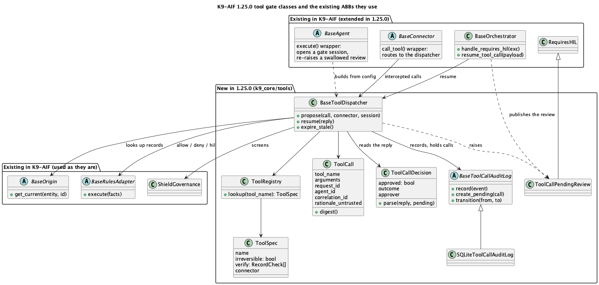

> **Summary.** An agent can be hijacked only where a model makes the decision. In an application built on K9-AIF:
>
> - [k9x Shield](../k9x-shield-chain-of-vulnerability-tests/) screens at every stage: the Router, the Orchestrator and the agent. Most attacks stop at the Router or the Orchestrator. Shield is a chain of 15 checks, mapped to the [OWASP](https://genai.owasp.org/) Top 10 lists for LLM and agentic applications and to the agent threats [Zscaler ThreatLabz](https://www.zscaler.com/threatlabz) describes. [K9X Sentinel](../k9x-inspector-and-sentinel-protected-current-compliant/) keeps it current, and during testing [K9X SATAN](https://satan.k9x.ai) attacks the application to prove the defences hold.
> - If an injection still reaches an agent, the agent can only *request* an action. Code, business rules and people decide whether it happens. The tool gate, when switched on, checks every MCP tool call before it runs.
> - Everything agents do is logged and reported, so anything unusual is seen and reviewed.

This morning, in a LinkedIn thread about agent identity, I described how I check an agent's work at two gates: once before a tool call goes out, and again on what the agent produces. One of the replies made a fair point. An injected action that fits the task closely enough will pass both gates, so for anything irreversible, the person who owns the request has to confirm it.

That's right, and it made me ask a more basic question: in K9-AIF, what does a "hijacked agent" even mean?

## What an agent hijack is

An agent is hijacked when untrusted content (a user message, an email, a document, a web page) makes it act against its purpose, using its own permissions. This is [prompt injection](https://genai.owasp.org/llmrisk/llm01-prompt-injection/).

It is a real risk only when three conditions hold at the same time:

1. **A model makes the decision.**
2. **The model reads untrusted content.**
3. **The agent can reach valuable data or take a consequential action.**

A hijacked agent can then do something it shouldn't, reveal something it shouldn't, or promise something it shouldn't.

## One example: a refund

A customer chats with an online support agent: "My order arrived damaged. Please refund me."

If that agent holds a tool like `issue_refund`, all three conditions hold. The model decides whether to refund and how much, and a cleverly worded message can talk it into a refund that isn't owed, or a bigger one. Every check passes, because the request is well formed and the tool is the right one.

## How K9-AIF avoids an agent hijack

**The agent is our code.** It reaches its tools only through a trusted MCP server, and its base class runs the checks around every call. In production, no prompt can turn those checks off, give the agent a new tool, or widen what it may do.

**Injection is caught before the model acts on it.** k9x Shield's `PromptInjectionCheck` screens the user's message and what the agent reads, such as attached documents and tool results. Guardian, where it's enabled, catches reworded attempts that no fixed pattern matches.

**Most flows have no model in them.** K9-AIF has two kinds of path ([more on routing them](../Routing-in-k9-aif/)):

- **Deterministic flows** are most business flows: look up, match, apply the rules, post. Our code decides every step, and the Orchestrator calls the enterprise systems through integration adapters. No model decides, so condition 1 never holds: **a deterministic flow can't be hijacked.** Its only risk is a wrong record, and the usual business controls already deal with that.
- **Non-deterministic flows** are where a model reads free text and chooses what to do. Only these can be hijacked. A hijacked agent can try three things, and each is covered:
  1. **Acting:** the agents' tools only submit requests into the existing workflows; they don't change records themselves, so the usual business rules still apply. As a backstop, the tool gate (1.25.0) sends any irreversible call the rules don't allow to a person, even when the agent's own code never asks for review.
  2. **Revealing:** every caller is signed in and role-checked. The agent gets only the tools a trusted MCP server offers it, those tools return only what the person may see, and Shield checks what goes out for personal and confidential data.
  3. **Misrepresenting:** Shield, and Guardian where it's enabled, check everything the agent sends out, and answers come from the solution's own approved policy text.

**For the refund,** the solution takes the conditions away with what the framework already provides:

| What the solution does | Condition it removes | What K9-AIF provides |
|---|---|---|
| Runs deterministic steps without a model | 1 | Integration adapters (API, rules, BPM, data) that the Orchestrator calls |
| Gives the agent `create_refund_request`, not `issue_refund` | 3 | The trusted MCP server offers only the request tool; Shield's tool authorization, when configured, refuses any tool not on the approved list |
| Lets the existing workflow decide | 3 | The solution's rules engine, through `BaseRulesAdapter`: a small refund with a delivery problem on record is approved automatically; a larger one, or a second refund on the same order, goes to a person |
| Asks for a person in code, not by the model's choice | 1 | `RequiresHIL`, raised by the agent's code or a rules step; the Orchestrator publishes the review |
| Screens what reaches the model | 2 | Shield's prompt-injection check on the message and on what the agent reads; Guardian catches rewordings |
| Checks who is asking | (who may ask at all) | Sign-in checked at the Router; Zero Trust role checks at the Orchestrator |
| Gives each agent only the tools it needs | 3 | The trusted MCP server offers each agent only its own tools (in development, a tool list in the agent's YAML) |
| Checks everything the agent sends out | (what it says and reveals) | Shield on every output, and Guardian where it's enabled |

With only the request tool, the most a clever message can do is get the agent to *submit a request*, and that request meets the same rules an online form would. **The model can be fooled; the workflow can't be skipped.**

## What K9-AIF 1.25.0 adds

Everything above relies on each solution being built that way. The tool gate makes it the framework's job: even if an agent is given an action tool, it can't use it to skip the workflow. One setting turns it on: `security.tool_gate.enabled: true`.

- **Every MCP tool call an agent makes is checked before it runs.** The agent's code doesn't change, and it can't turn the check off. Agent code that goes around MCP with its own network call is flagged by Inspector rule K9-TOOL-001.
- **Each tool is declared reversible or irreversible.** `create_refund_request` can be undone, so it runs. `issue_refund` can't be undone. A tool nobody declared counts as irreversible.
- **The solution's rules decide what happens to an irreversible call:** run it, refuse it, or send it to a person. If no rule allows it, a person decides. So a small, routine refund can run automatically, while anything the rules don't allow waits for a person.
- **An approval runs that exact call, once.** A rejected, expired or late reply never runs it.
- **Everything is recorded:** the call, the decision, who approved it and when.

Each of these is proven by a test that runs against the framework's real agent and tool-call wrapping, orchestrator and audit log, with a stand-in tool server: [31 tests in `test_tool_gate_1_25.py`](https://github.com/k9aif/k9-aif-framework/blob/v1.25.0/k9_aif_abb/tests/test_tool_gate_1_25.py), at the v1.25.0 release.

It's off by default in 1.x, so existing applications don't change when they upgrade. It becomes the default in 2.0.

## What could still get through

A few things can: an approver who approves without reading, a request that looks completely normal, a record someone already changed. No framework stops everything. The goal is to stop as much as possible and to see the rest quickly. The gate records every call and decision, the framework's monitors report what agents did, and the solution's alerts and regular reviews look for what doesn't fit. Limit the worst case in advance, so that whatever gets through stays small.

## Class Diagram



## Configuration

```yaml
security:
  tool_gate:
    enabled: true
    rules: {adapter: rest_rules, engine_url: "${RULES_ENGINE_URL}", ruleset: tool_calls}
    tools:
      create_refund_request: {irreversible: false}
      issue_refund:
        irreversible: true
        connector: {client: streamable_http, params: {config: {kwargs: {url: "${PAYMENTS_MCP_URL}"}}}}
```

To apply a reviewer's decision, the orchestrator adds one line at the top of `execute_flow()`: `resumed = self.resume_tool_call(payload)`. Held calls are kept in the gate's audit log (SQLite by default), so the agent workers and the Orchestrator must share it.

## Closing

No framework makes an agent safe. You do your level best, keep your defences current, and keep looking back at what happened. After a certain point nothing more can be done, so decide that point in advance. Cap what an agent can do, know who owns the risk that's left, and make sure that when something does get through, it's small, it's visible, and it's someone's decision that it was acceptable.

## Related posts

- [Agents Act for the Person Who Asked: Keycloak, Token Exchange and MCP](../agents-act-for-the-person-who-asked/)
- [Routing in K9-AIF: Deterministic and Non-Deterministic Paths](../Routing-in-k9-aif/)
- [Not Every Agent Needs an LLM](../not-every-agent-needs-an-llm/)
- [K9X Shield — Part 1: Zero Trust for Agentic Systems](../zero-trust-execution-layer-agentic-systems/)
- [K9X SATAN — Proving Shield Actually Holds](../k9x-satan-proving-shield-holds/)
- [How K9X Streams Enhances the K9-AIF Framework](../how-k9x-streams-enhances-k9-aif/)
- [The 4Ds of AI Fluency — Encoded Into Architecture](../4ds-ai-fluency-encoded-architecture/)
