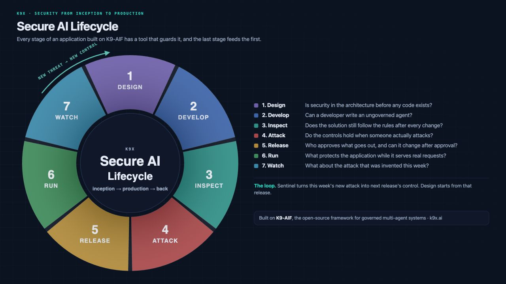

<!-- DRAFT: depends on k9-aif 1.27.0 (catalog 38 controls, 6 known gaps; Inspector 32 rules). Fill the two video links before go. -->

Most AI security advice covers one moment. A prompt filter. A red-team exercise the week before launch. Then the
agent ships, and the attacks keep changing.

In K9X, security is a loop with seven stages, and each stage has a tool behind it. The last stage feeds the first:
this week's new attack becomes next release's control.



Each stage answers one question:

| Stage | Question | Tool |
|---|---|---|
| 1. Design | Is security in the architecture before any code exists? | K9X Studio + the control catalog |
| 2. Develop | Can a developer write an ungoverned agent? | K9-AIF `BaseAgent` |
| 3. Inspect | Does the solution still follow the rules after every change? | K9X Inspector |
| 4. Attack | Do the controls hold when someone actually attacks? | K9X SATAN |
| 5. Release | Who approves what goes out, and can it change after approval? | K9X Enterprise Repository |
| 6. Run | What protects the application while it serves real requests? | k9x Shield, HIL, tracing |
| 7. Watch | What about the attack that was invented this week? | K9X Sentinel |

## 1. Design

[K9X Studio](https://studio.k9x.ai) takes the process you already have (a BPMN diagram, a process specification or
an agent evaluation plan) and turns it into a governed K9-AIF architecture. It maps each step onto
Router → Orchestrator → Squad → Agent and generates the project with Shield, Zero Trust and human-in-the-loop hooks
already wired in.

The controls themselves live in one catalog,
[`capabilities.yaml`](https://github.com/k9aif/k9-aif-framework/blob/main/k9_aif_abb/k9_security/capabilities.yaml):
38 controls in k9-aif 1.27.0, each mapped to the
[OWASP Top 10 for LLM Applications (2025)](https://genai.owasp.org/) and the OWASP Top 10 for Agentic Applications
(2026). The same file lists 6 known gaps in the open. An architect designs against what exists, and can see what
doesn't yet.

## 2. Develop

Governance is part of the base agent, not something a developer remembers to call. When a class extends
`BaseAgent`, the framework wraps its `execute()` at class creation, so overriding the method doesn't skip the
checks. In production, an agent with no governance configured refuses to run:

| Test (k9-aif, `test_governance_by_construction.py`) | Proves |
|---|---|
| `test_overriding_execute_does_not_bypass_governance` | an override is still governed |
| `test_production_refuses_ungoverned_agent_before_it_runs` | no governance, no run |
| `test_unset_k9_env_counts_as_production` | forgetting to set the environment is not a loophole |

Model calls go through one governed path, `llm_invoke()`. Code that calls a model client directly is what the next
stage looks for.

## 3. Inspect

[K9X Inspector](https://inspector.k9x.ai) checks a solution against the framework's inspection rules (32 in 1.27.0)
on every GitHub push, through a signed webhook. Each violation comes with a fix. One rule flags any agent that
reaches a model without going through `llm_invoke()`. More in the
[Inspector and Sentinel post](/k9x-inspector-and-sentinel-protected-current-compliant/).

## 4. Attack

[K9X SATAN](https://satan.k9x.ai) fires 16 real attacks at a running application (prompt injection, system-prompt
leakage, memory poisoning, shadow tools, PII exfiltration, request floods and more) and reports how far each one
got. Anything that gets through goes back to the architect to fix before release. The
[SATAN post](/k9x-satan-proving-shield-holds/) shows a full run.

## 5. Release

The solution is recorded in the [K9X Enterprise Repository](https://repo.k9x.ai), which points to its
implementation code. That's where approval lives. See
[TOGAF made real](/k9x-enterprise-repository-togaf-made-real/).

Approval also has to hold after the fact. A locally served model can be pinned by its digest (k9-aif 1.18.6, Ollama
backend). If the model behind that name is swapped later, the application stops before sending it a single prompt
(`test_ollama_refuses_before_sending_the_prompt` in `test_trace_and_model_integrity.py`).

As maturity grows, Enterprise Continuum can be added: reusable SBBs are promoted to ABBs for enterprise-wide reuse.

<!-- RAVI: Video on Enterprise Repository & Continuum: replace with the YouTube URL (LinkedIn short link was lnkd.in/erSsRPpT). -->

## 6. Run

k9x Shield runs [15 checks](/k9x-shield-chain-of-vulnerability-tests/) on inputs and outputs: injection, PII,
tool arguments and authorization, output sanitization, payment diversion and others. High-risk decisions stop for
a person through the HIL orchestrator. One trace id follows each request end to end, so every event of a run can be
tied back to it (`test_every_event_of_a_run_carries_the_runs_id_sequential_and_parallel`).

## 7. Watch

Every morning [K9X Sentinel](https://sentinel.k9x.ai) reads new AI-security research and checks it against the
catalog, including an OSV audit of the framework's dependencies.

On October 16 it flagged the MCP SDK the framework depended on:
[GHSA-84m7-p3x7-pcfv](https://github.com/advisories/GHSA-84m7-p3x7-pcfv) (CVE-2026-59951), unbounded session
accumulation in the StreamableHTTP transport. The fix, k9-aif 1.18.4 raising the floor to `mcp` 1.30.0, shipped the
same day.

## Stage 7 feeds stage 1

That's the point of the loop. A new attack found in Watch becomes a control in the catalog, the catalog is what
Design starts from, and every application built on K9-AIF gets the control with an upgrade:

```bash
pip install --upgrade k9-aif
```

No team has to rediscover the attack on its own.

## Try it

- 3-minute walkthrough: <!-- RAVI: replace with the YouTube URL (LinkedIn short link was lnkd.in/ebfiPphX). -->
- [k9x.ai](https://k9x.ai) · `pip install k9-aif` · [github.com/k9aif](https://github.com/k9aif)
