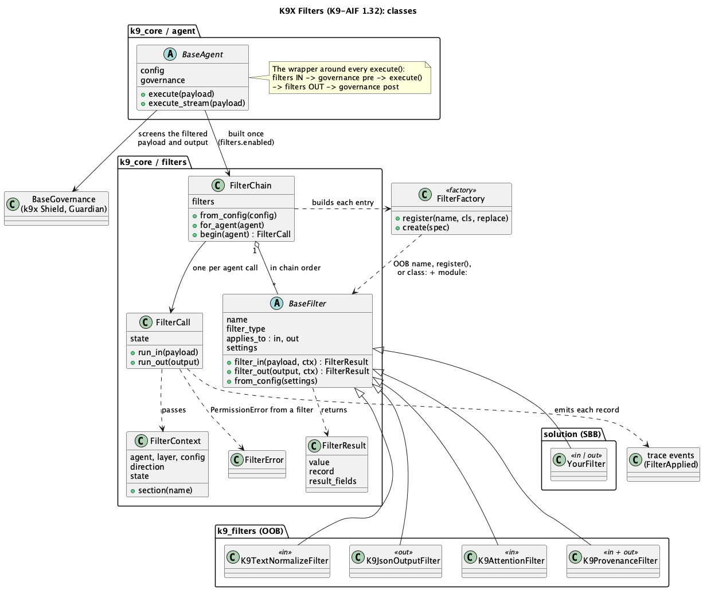
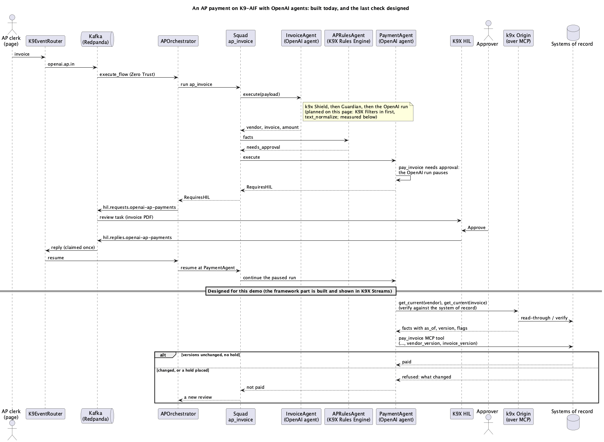
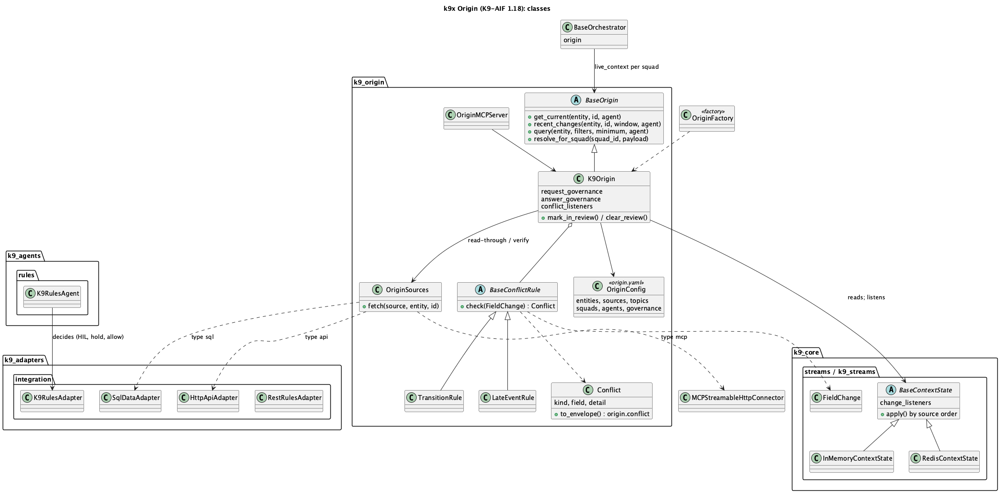

<!-- DRAFT: depends on k9-aif 1.32.0 (released 2026-11-19, PyPI + DOI 10.5281/zenodo.24383309).
Before the go: (1) fill the RAVI placeholders; (2) the attention correction (planned 1.32.1: a quarantined
Origin answer is labelled, not removed) is released, or the attention paragraph keeps its current wording;
(3) if the openai.k9x.ai AP page has the hidden-attack cards by then, link them; (4) set the date. -->

<!-- RAVI: the opening. A real moment you saw: an agent working from the wrong or stale context, a payment
approved on facts that had changed, text slipping past a check. Two or three sentences in your words. -->

## Filters

This started with a pattern, not a feature. I kept thinking about a chain of filters: each one does one
small job on what passes through, hands it to the next, and a new one can be added to the chain without
touching the others. Attention first, then formatting, then whatever the next real problem turns out to be.
It is the shape of the Chain of Responsibility pattern, applied to what an agent receives and returns.

<!-- RAVI: one or two sentences on why the chain idea stuck with you (where you've used it before). -->

A filter changes what passes through an agent: it removes, normalizes, labels, ranks or attaches. It
never blocks, and every change it makes is recorded. Each filter does one job, so the chain grows one
filter at a time.

## The chain of filters

### Where it runs

The idea became a change to the framework itself, in the same pattern the framework already uses for
governance. K9-AIF wraps every agent's `execute()` when the class is defined, so governance runs without
the agent doing anything. Filters went into that same wrapper:

```
caller -> filters IN -> Shield / Guardian (pre) -> agent.execute() -> filters OUT -> Shield / Guardian (post)
```

Two choices in that line matter:

- **In filters see the payload before the agent's own code runs.** At that point it is still a set of named
  parts (the request, the policy, retrieved text, a vendor's email). Once the agent has built its prompt,
  it is one string and nothing can tell the parts apart.
- **Governance always screens the final form.** Shield sees exactly what the agent will receive, and
  anything a filter adds to the output.

It is off unless the application turns it on, and then every agent gets it, from configuration.

### The classes



`BaseFilter` is the contract: `filter_in`, `filter_out`, and which directions it applies to. Each returns a
`FilterResult`: the new value, a record of what changed (emitted as a `FilterApplied` trace event) and, for
an out filter, fields to add next to the output. `FilterChain` holds an agent's filters in order;
`FilterFactory` builds them by name, by registration, or from a class and module in config. The four that
ship live in `k9_filters`; a solution adds its own next to them.

A filter of your own is a small class:

```python
import re
from k9_aif_abb.k9_core.filters.base_filter import BaseFilter, FilterResult

class TicketIdFilter(BaseFilter):
    name = "ticket_ids"
    filter_type = "normalize"
    applies_to = ("out",)

    def filter_out(self, output, ctx):
        if not isinstance(output, str):
            return FilterResult(output)
        new, n = re.subn(r"TCK-\d+", "[ticket]", output)
        return FilterResult(new, record={"replaced": n} if n else {})
```

Two rules come with it. A filter never blocks: if one raises a permission error, the chain turns it into a
filter error, because blocking is Shield's job. And a filter never fails quietly: if it can't do its job,
the agent fails, like any other agent failure.

### What ships

| Filter | Direction | What it does |
|---|---|---|
| `text_normalize` | in | Unicode NFKC, invisible characters removed, invisible tag characters made visible |
| `attention` | in | ranks retrieved text against the question and keeps what fits a token budget; parts declared as policy are never cut; labels each part's trust from the agent's own declaration |
| `json_output` | out | the JSON in the model's reply, validated, or a recorded failure |
| `provenance` | in + out | `sources` on the result, from the k9x Origin facts the agent was given |

`attention` replaces a line many agents carry, `context = source[:8000]`, which keeps whatever came first
and records nothing about the rest. The labels come from the agent's YAML, never from the request, so a
caller can't mark its own email as trusted.

Configuration, in the application and in one agent's YAML:

```yaml
# config/config.yaml
filters:
  enabled: true
  chain: [text_normalize, attention, json_output, provenance]

# agents/yaml/invoice_reviewer.yaml
agent_filters:
  attention:
    pinned:    [policy]
    retrieved: [policy_chunks]
    untrusted: [vendor_email]
    budget_tokens: 4000
  json_output:
    required: [decision, reason]
```

## How it contributes

### What the first filter found

Building `text_normalize` turned up a real gap. Shield's `PromptInjectionCheck` blocks "ignore all previous
instructions". It did not block the same words with a zero-width space inside one of them, in fullwidth
letters, or in Unicode tag characters, which are invisible on screen but which models can read. A pattern
check compares characters; a model reads meaning.

I then ran the accounts payable squad from [openai.k9x.ai](/k9-aif-with-openai-agents-sdk/) (OpenAI
agents, k9x Shield, Granite Guardian, the K9X Rules Engine) with two of the page's own bad invoices, each
hidden with zero-width characters:

| Attack | Guardian | Filters | What happened |
|---|---|---|---|
| hidden instruction | off | off | passed Shield; the OpenAI agents ran; the AP rules held the payment for a person |
| hidden instruction | on | off | blocked by Guardian after 11 seconds (one model call) |
| hidden instruction | on or off | on | blocked by Shield before any model ran; 2 invisible characters removed |
| hidden payment diversion | off | off | passed Shield; agents ran; the rules held it |
| hidden payment diversion | on | off | blocked by Guardian after 12 seconds |
| hidden payment diversion | on or off | on | blocked by Shield, all three diversion signals matched; 6 removed |

Guardian, which reads meaning, caught both. With the filter, the cheap deterministic layer catches them
first, in no time, the same way every run, and the record says exactly what was hidden.

<!-- RAVI: your view on layering here (deterministic first, the model as the second opinion). -->

Shield's own checks should not depend on a filter being switched on. Normalizing inside Shield's checks
is planned for 1.33.0.

### A critical task: an AP payment, end to end

Accounts payable is where this has to hold. Here is the payment flow with OpenAI agents, governance on,
and a person approving through K9X HIL:



Built and running today:

- Shield, then Guardian, screen every agent; Zero Trust decides who may submit.
- The OpenAI agent reads the invoice; the rules decide on facts from the records, not from the model.
- When the rules say a person must approve, the OpenAI run pauses. The Orchestrator publishes the review on
  Kafka; the approver clicks Approve in K9X HIL; the reply comes back on Kafka; the Router claims it once
  and the paused run continues.

The last check, after the approval and just before the money moves, is where k9x Origin comes in. An
approval can wait hours. In that time the vendor's bank account can change or someone can put the invoice
on hold. Origin, built into the framework, answers "what is true right now" from the systems of record and,
when plugged in, from event streams; an agent asks it over MCP, and each answer carries `as_of`, `version`
and flags. These are its classes:



[How K9X Streams enhances K9-AIF](/how-k9x-streams-enhances-k9-aif/) shows it working on an AP domain:
Kafka topics, the Shield gate, live state, and agents re-checking over MCP before they act.

For the payment the design adds one rule: the approved payment carries the versions of the facts the
approver saw, and the system that moves the money refuses if either changed. That makes the system of
record the last line, which matters for a stop decided at the last moment:

| Where the stop decision is | What catches it | Window |
|---|---|---|
| Recorded in the system of record (a hold) | the payment checks hold and versions in the same transaction | none |
| Only an event, already applied to live state | Origin's check just before payment | covered once applied |
| An event still in flight | nothing yet | milliseconds to about a second |

So a stop is written to the system of record and published as an event. The system of record makes the
withholding certain; the stream makes it visible early. For the openai.k9x.ai demo this last part is
designed, not built; the framework pieces it uses are.

## What the agent SDKs offer

Both SDKs have a hook in this area, and both keep blocking and changing apart, the same split as above.

| | OpenAI Agents SDK 0.24 | Claude Agent SDK 0.2 | K9X Filters |
|---|---|---|---|
| Block | input, output and tool guardrails (a tripwire stops the run) | `PreToolUse` deny, `UserPromptSubmit` block | Shield, Guardian, Zero Trust |
| Change what the model sees | `RunConfig.call_model_input_filter`, a function you write, before each model call | `PreToolUse` `updatedInput`, `PostToolUse` `updatedToolOutput` | the filter chain |
| Where it lives | code, per run | code, per session | configuration, every agent |
| Ships with implementations | handoff filters | none | four |

Sources: [openai-agents-python](https://github.com/openai/openai-agents-python) (`agents/run_config.py`),
[claude-agent-sdk-python](https://github.com/anthropics/claude-agent-sdk-python) (`types.py`).

What K9-AIF adds is everything around the hook: a chain in configuration, applied to every agent, with
filters that use what the framework already knows (Origin's facts, an agent's declared parts) and a record
of every change. The two hooks are also where the filters go next: OpenAI's model-input filter and
Claude's tool-output hook let the framework's adapters run the same chain inside each SDK's own loop.

## Limits

- Filters run at an agent's input and output. Inside an orchestrator adapter's own loop (a whole OpenAI
  handoff group, a CrewAI crew) they don't run yet.
- Relevance in `attention` is word overlap in 1.32: "payment" doesn't match "pay". An embedding scorer is
  a later version.
- Streamed replies get in filters only; their chunks are sent as they arrive.

## Try it

- `pip install -U k9-aif` (1.32.0), or the framework's
  [K9X Filters demo](https://github.com/k9aif/k9-aif-framework/tree/main/examples/k9x_filters_demo): one
  agent, filters off and on, a real model.
- Design: [k9x-filters-design.md](https://github.com/k9aif/k9-aif-framework/blob/main/docs/roadmap/k9x-filters-design.md).
  Tests: `k9_aif_abb/tests/test_filters_1_32.py`.
- Release: [PyPI](https://pypi.org/project/k9-aif/1.32.0/), DOI
  [10.5281/zenodo.24383309](https://doi.org/10.5281/zenodo.24383309).

<!-- RAVI: the closing. The one thing you want an architect to take away, in your words. -->
