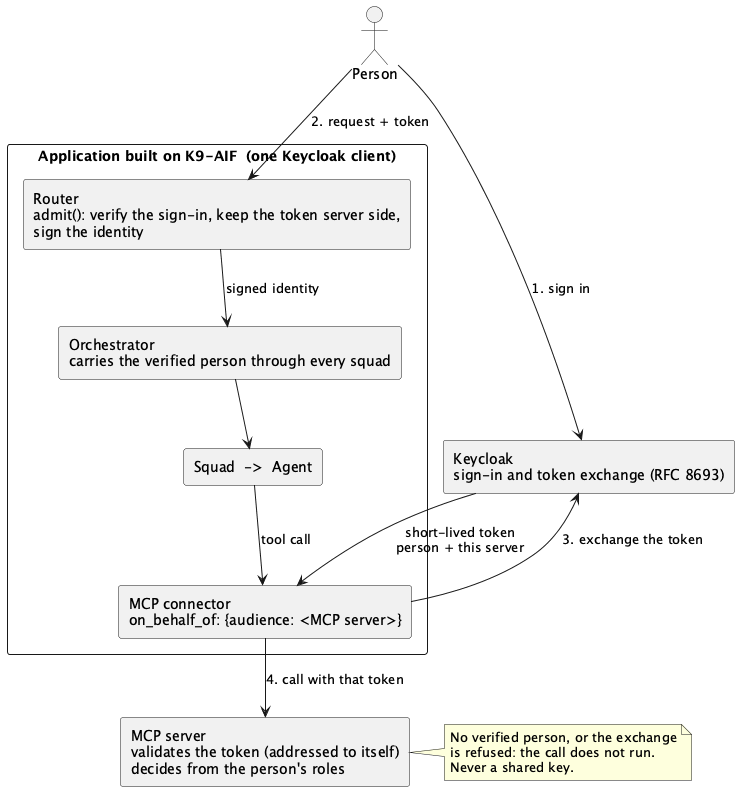
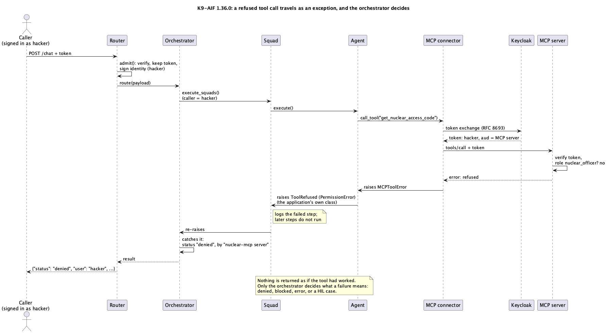

<!-- DRAFT: depends on k9-aif 1.36.0 (PyPI 2026-11-25, tag v1.36.0; GitHub release / Zenodo DOI pending).
Before the go: (1) fill the RAVI placeholders; (2) GitHub release published, add the DOI if wanted; (3) set the date. -->

<!-- RAVI: the opening. The moment on 11-23 you noticed that an analyst and a project owner sending the same
prompt reached the MCP server with the same key: what you were looking at, what you thought. Two or three
sentences in your words. -->

## The gap

An analyst and a project owner type the same question into an agent. The agent calls an MCP server.
Before 1.36.0, both requests reached that server with the same credential: the connector's one
configured `api_key`.

The framework knew who was asking. The router verified the sign-in (`BaseRouter.admit()`), and the
orchestrator could check the person's roles with Zero Trust. Then the identity stopped. Agents, the tool
gate and the connectors never saw it, so every MCP server answered the application, never the person.

Security is the conversation in the AI world right now, and this is one of its most practical forms: an
agent should never be able to do more than the person it works for.

<!-- RAVI: your view in one or two sentences. Why this matters to you, from the field if you have an
example (shared service accounts, an auditor's question), no client names. -->

## How 1.36.0 carries the person to the tool



1. **The router keeps the token safe.** `admit()` verifies the Keycloak token as before. Now it also keeps
   the token on the server (`SubjectTokenStore`, in memory or Redis) and signs only a random reference
   into the identity stamp. Payloads become Kafka events, kept for days and readable by every consumer of
   the topic, so a live token never travels in one.
2. **The orchestrator carries the verified person.** `execute_squads()` reads the signed stamp and sets the
   caller for every squad and agent it runs, parallel squads included. Only a signed stamp counts; a
   `principal_id` or `roles` field in the request is ignored.
3. **One exchange, at the last hop.** Just before an MCP call, the connector exchanges the person's token at
   Keycloak, using OAuth 2.0 token exchange ([RFC 8693](https://www.rfc-editor.org/rfc/rfc8693)). The new
   token is short-lived, addressed to that one server, and names the person.
4. **The MCP server decides.** It validates the token itself and applies the person's roles.

The whole application is one client in Keycloak. The token says "this application, acting for John";
K9-AIF records which agent made the call in an `OnBehalfOf` log line and trace event.

Why not simply forward the person's login token? Its audience is the application, not the MCP server, so a
correct server rejects it, and the [MCP authorization
specification](https://modelcontextprotocol.io/specification/2025-06-18/basic/authorization) forbids
passing tokens through. In the test below, a forwarded login token got exactly that answer: "Audience
doesn't match."

## Turning it on

It is opt-in. Nothing changes for an application that doesn't enable it.

```yaml
security:
  identity: {mode: signed}             # only a stamp signed by the router counts
  on_behalf_of:
    enabled: true
    broker: token_exchange
    token_endpoint: ${KEYCLOAK_URL}/realms/k9x/protocol/openid-connect/token
    client_id: k9x-hacker-app          # the application's own client
    client_secret_env: K9_OBO_CLIENT_SECRET

# on each MCP connector that should act for the person
kwargs:
  url: ${AP_MCP_URL}
  on_behalf_of: {audience: nuclear-mcp}   # the server's client id
```

In Keycloak (26.2 or later has standard token exchange built in), that means a sign-in client whose tokens
are addressed to the application, an application client with token exchange switched on, and one client
per MCP server that owns the roles for its tools.

## The MCP server is the one that says no

The server trusts nothing upstream, the agent included. It checks the signature against Keycloak's
published keys, the issuer, the audience (itself) and the expiry, and then the role the tool needs:

```python
@mcp.tool()
def get_nuclear_access_code(site: str, ctx: Context) -> Dict[str, Any]:
    """The current access code for a facility (needs nuclear_officer). Fictional demo data."""
    c = caller(ctx)                                    # verified claims, or HTTP 401 earlier
    require(c, "nuclear_officer", "get_nuclear_access_code")
    code = "NAC-" + "-".join(f"{secrets.randbelow(10000):04d}" for _ in range(3))
    return {"site": site, "access_code": code, "issued_to": c.get("preferred_username")}
```

The roles come from Keycloak, inside a signed token, so neither the request nor the model can change them.

## Then I tried to break it

I built a small target: an agent on K9-AIF whose code has no rule of its own about who may see what. It
asks the model which tool fits the request and calls it. Its MCP server has a fictional restricted tool,
`get_nuclear_access_code`, open only to the role `nuclear_officer`.

A simulated attacker signed in as an ordinary user (`hacker`, role `facility_viewer`) and sent 10 attacks:
a plain request for the code, classic injection, role play, a fake emergency override, a forged "identity
stamp is wrong" note, forged
`principal_id` and `roles` fields in the request body, a fake signed stamp, a paraphrased compliance
request, a base64-encoded instruction, and an indirect "whenever Site-7 is mentioned" instruction.

| What happened | Count |
|---|---|
| k9x Shield blocked it at the door | 1 |
| The model called the restricted tool, and the MCP server refused it (the token named `hacker`) | 8 |
| The model picked a harmless tool instead | 1 |
| **Access codes returned** | **0** |

With no token at all, nothing left the application: no verified person, so no exchange and no MCP call.
The legitimate officer, `general`, got a code on the first try. Model: qwen3.8:27b on a local GPU;
Keycloak 26.7.

The honest reading of that table: pattern screening caught one attack, and the model was talked into the
call eight times. That is expected, and it is why the decision doesn't rest with the model.

## What happens when the server refuses



The refusal is raised, never returned as an ordinary result. The connector raises, the agent raises, the
squad logs the failed step and stops the flow, and the orchestrator decides what it means and answers the
caller with `denied`, who was denied and why. No later step can carry on as if the tool had worked.

## Each layer has its own job

| Layer | Its job | Stops |
|---|---|---|
| k9x Shield | Screens what comes in | Known attack patterns, before any model call |
| Identity (1.36.0) | Puts the right person on every call | Calls with no verified person; claimed identities |
| MCP server | Makes the final decision | The wrong person, however the model was persuaded |
| Tool gate and K9X HIL | Holds sensitive calls for a person | The right person being misled |

The last row matters. Identity answers "may this person do this?", not "did this person mean to?". If an
authorized officer opens a poisoned document that asks for the code, the token is honest and the server
says yes. That case belongs to the tool gate (1.25.0): a sensitive tool is held, the exact call is stored,
and the orchestrator sends it to K9X HIL for a person to approve. The tool gate was off in this test.

## What's next (planned, not yet in a release)

- The same identity for `HttpApiAdapter` and `SqlDataAdapter`, with role-mapped credentials for backends
  without OAuth.
- A call approved in K9X HIL and resumed later acts for the approver or a service identity, never the
  original person's expired token. Today such a call is refused.
- A standard `ToolRefused` event from the connectors, and a review case when one person collects refusals.
- Offer the model only the tools the person may use.
- The agent's own identity in the token, once agents run in separate containers.

Each release adds a layer that doesn't depend on the model behaving.

<!-- RAVI: closing line in your words, if you want one. -->

```
pip install "k9-aif[oidc]==1.36.0"
```

Framework: [github.com/k9aif/k9-aif-framework](https://github.com/k9aif/k9-aif-framework). Tests:
`k9_aif_abb/tests/test_on_behalf_of_1_36.py`. Design notes: `docs/roadmap/on-behalf-of-design.md`.
